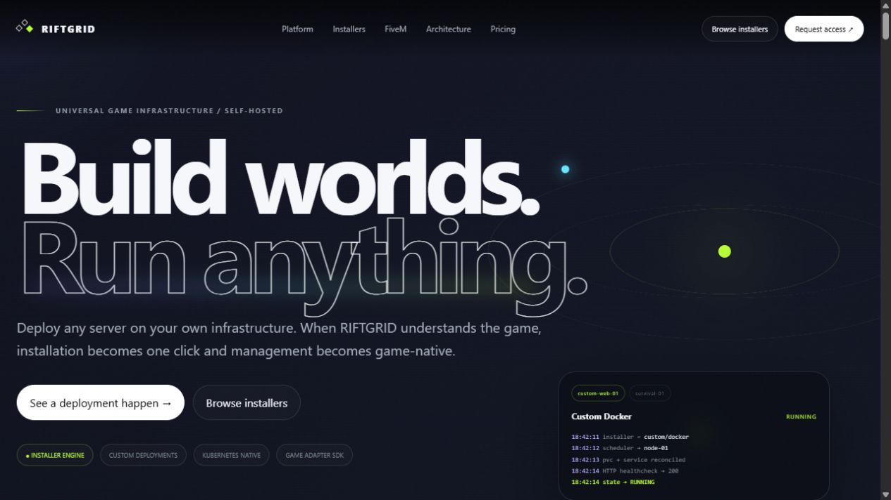
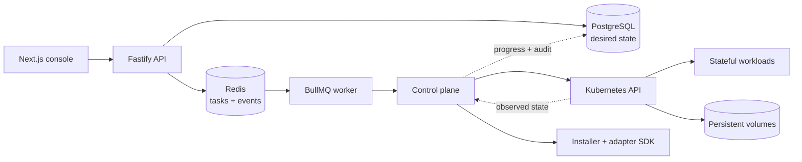

<div align="center">

# RIFTGRID

### Build worlds. Run anything.

**A self-hosted, desired-state control plane for persistent game infrastructure on Kubernetes.**

[](https://github.com/Mischmaschine/RIFTGRID/actions/workflows/ci.yml)


[Quick start](#quick-start) · [Architecture](docs/architecture.md) · [Documentation](#documentation) · [Wiki](https://github.com/Mischmaschine/RIFTGRID/wiki) · [Security](SECURITY.md)

</div>



RIFTGRID turns operator intent into real, inspectable Kubernetes resources. PostgreSQL stores desired state, Redis transports work, workers reconcile it, and Kubernetes runs the workloads. Installers describe how software reaches `RUNNING`; game adapters add game-aware health, players, console, configuration, worlds, and resources.

> The infrastructure stays visible. Scheduling decisions are explainable, persistent data remains yours, and recovery converges reality back toward intent.

## Why RIFTGRID

| Capability | What it means |
| --- | --- |
| **Universal deployments** | Run validated installers or define a custom OCI image, command, ports, secrets, volumes, resources, and health checks. |
| **Desired-state operation** | Start, stop, restart, reconcile, migrate, back up, and restore through durable asynchronous tasks. |
| **Kubernetes-native runtime** | StatefulSets, Services, PVCs, Secrets, Jobs, scheduling policy, and live cluster inventory remain first-class. |
| **Persistent by design** | Workload replacement does not imply world replacement. Storage identity and recovery boundaries are explicit. |
| **Game-aware adapters** | Minecraft is deeply integrated; FiveM support is implemented up to its external Cfx.re credential boundary. |
| **Operational visibility** | Live state, task progress, activity history, console transport, node capacity, networking, and storage in one UI. |
| **Self-hosted control** | Your cluster, your data, your credentials, and no infrastructure-provider lock-in. |

## Architecture



The control plane continuously compares desired and observed state. Every mutation is expressed as a task, guarded against competing operations, and reconciled through the Kubernetes API. Read the full [architecture guide](docs/architecture.md) and [desired-state model](docs/desired-state.md).

## Current capability snapshot

- Minecraft Paper/Vanilla deployment with persistent worlds, health, RCON, players, console, backup, restore, and restart-safe reconciliation.
- Generic Docker/OCI deployments using the same scheduler, state machine, storage, networking, and task pipeline.
- FiveM installer, adapter, runtime image, txAdmin path, optional managed-database binding, and Secret-only Cfx.re license handling.
- Managed MariaDB/MySQL with Kubernetes Secret, PVC, Service, StatefulSet, lifecycle controls, and deployment association.
- Installer catalog, deployment templates, node policies, RBAC, organization limits, audit activity, tasks, storage, network, cluster, and adapter views.
- Public multi-page product site at `/`; authenticated operations console at `/dashboard`.

The detailed implementation and acceptance status lives in [PLAN.md](PLAN.md).

## Quick start

### Guided Linux installation

On a clean Linux host, run the interactive all-in-one installer:

```bash
curl -fsSL https://raw.githubusercontent.com/Mischmaschine/RIFTGRID/main/install.sh | bash
```

The wizard checks prerequisites, asks for the public host and installation location, creates or safely reuses a dedicated k3d cluster, generates local secrets, starts PostgreSQL/Redis/the control plane, applies migrations, prepares runtime images, and verifies the result. It does not replace an existing checkout, cluster, database volume, or game PVC. See [Guided installer](docs/installer.md) for non-interactive options, lifecycle commands, networking, TLS, and the exact safety boundary.

### Prerequisites

- Node.js 20+
- pnpm 11.19.0
- Docker Desktop or another container runtime
- PostgreSQL and Redis
- A reachable Kubernetes cluster and current kubeconfig

### Local development

```powershell
Copy-Item .env.example .env
docker compose -f infrastructure/docker/compose.yml up -d
pnpm install --frozen-lockfile
pnpm db:migrate
pnpm dev
```

Open [http://localhost:3000](http://localhost:3000). The first unauthenticated console visit guides you through administrator creation/login. For an isolated local cluster, install k3d and run:

```powershell
pnpm cluster:dev
```

See [Installation](docs/installation.md), [Development](docs/development.md), and [Kubernetes access](docs/kubernetes.md) before targeting a non-development cluster.

## Quality commands

| Command | Purpose |
| --- | --- |
| `pnpm typecheck` | Type-check all 12 workspace packages |
| `pnpm lint` | Run repository lint checks |
| `pnpm test` | Run unit/domain tests |
| `pnpm build` | Build the complete monorepo |
| `pnpm db:migrate` | Apply Drizzle database migrations |
| `pnpm cluster:dev` | Create the local k3d development cluster |
| `riftgrid doctor` | Diagnose a guided Linux installation |

Run the four quality gates sequentially on Windows to avoid unnecessary concurrent filesystem pressure.

## Repository map

```text
apps/
  api/              Fastify HTTP/WebSocket API
  web/              Next.js console + public product site
  worker/           BullMQ task execution
packages/
  control-plane/    Reconciliation and lifecycle orchestration
  database/         Drizzle schema and migrations
  game-minecraft/   Minecraft adapter
  game-sdk/         Installer and adapter contracts
  kubernetes/       Kubernetes resource and observation layer
  scheduler/        Explainable placement decisions
  shared/            State machine, schemas, errors, shared types
infrastructure/
  docker/           Local PostgreSQL/Redis stack
  helm/             Kubernetes deployment chart
  images/           Runtime images
  kubernetes/       k3d development cluster
docs/               Architecture and operator documentation
```

## Documentation

| Area | Guide |
| --- | --- |
| Start here | [Installation](docs/installation.md) · [Development](docs/development.md) |
| Core model | [Architecture](docs/architecture.md) · [Desired state](docs/desired-state.md) · [Scheduler](docs/scheduler.md) |
| Kubernetes | [Cluster access](docs/kubernetes.md) · [Networking](docs/networking.md) · [Storage](docs/storage.md) |
| Operations | [Backups](docs/backups.md) · [Security](docs/security.md) |
| Game support | [Game adapters](docs/game-adapters.md) · [Minecraft](docs/minecraft.md) · [FiveM](docs/fivem.md) · [Rust](docs/rust.md) · [Valheim](docs/valheim.md) |

The GitHub [Wiki](https://github.com/Mischmaschine/RIFTGRID/wiki) provides a shorter operator-oriented path through the same material.

## Security and secrets

Never commit `.env` files, Kubernetes Secret values, database passwords, session secrets, kubeconfigs, backup archives, or Cfx.re license keys. RIFTGRID stores workload credentials in Kubernetes Secrets and references only their names from ordinary configuration.

Please report vulnerabilities privately using [SECURITY.md](SECURITY.md).

## Contributing

Read [CONTRIBUTING.md](CONTRIBUTING.md) before opening an issue or pull request. Changes should preserve desired-state semantics, persistent-data safety, RBAC boundaries, and sequential quality verification.

## License

No open-source license is declared in this repository. Publication of the source does not by itself grant redistribution or commercial-use rights.

<div align="center">

**Your hardware. Your games. One operating layer.**

</div>
