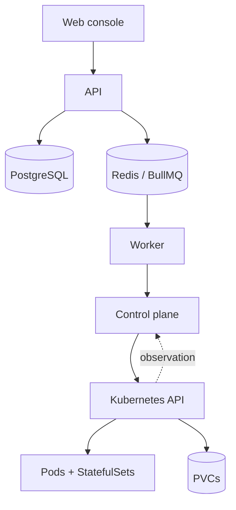

# Architecture

## Responsibility boundaries

- **Web:** operator workflows and live presentation.
- **API:** authentication, authorization, validation, ownership, and task creation.
- **Worker:** exclusive background execution of durable operations.
- **Control plane:** reconciliation, state transitions, scheduling, and activity recording.
- **Kubernetes package:** resource application, observation, exec/log transport, and data jobs.
- **Installer SDK:** versioned runtime definition and configuration schema.
- **Game adapter:** optional game-native capabilities and health.

Read the full [architecture](https://github.com/Mischmaschine/RIFTGRID/blob/main/docs/architecture.md), [desired-state](https://github.com/Mischmaschine/RIFTGRID/blob/main/docs/desired-state.md), and [scheduler](https://github.com/Mischmaschine/RIFTGRID/blob/main/docs/scheduler.md) guides.
